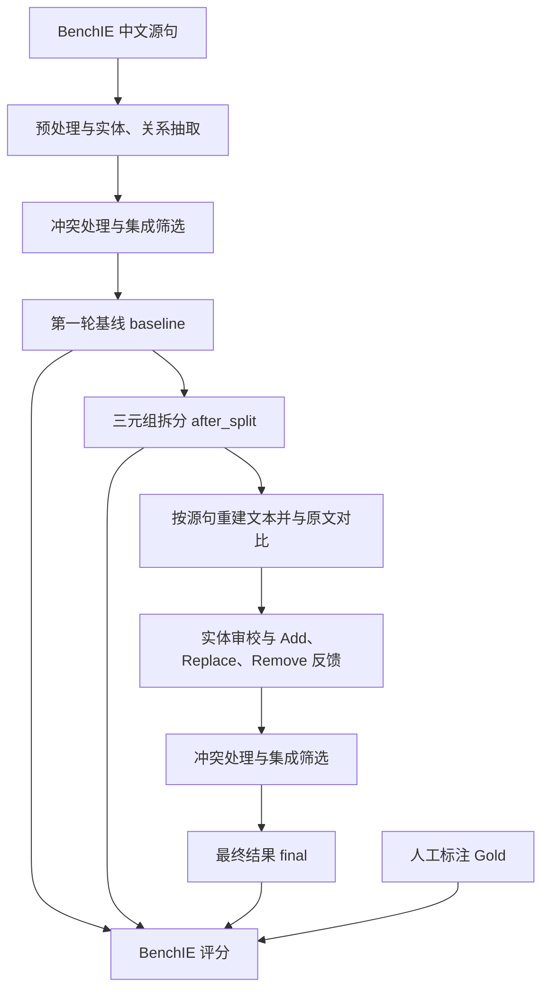

# KARMA · 中文三元组抽取与评估

KARMA 从原文中抽取「主体、关系、客体」三元组。当前 `main` 的默认数据集是 BenchIE 中文版，共 **300 句、995 个事实簇、1,134 条人工标注记录**。实际运行分三步：先生成第一轮基线，再复用基线做第二轮反馈，最后用 Gold 对照评分。

## 项目结构

| 位置 | 用途 |
| --- | --- |
| `main.py`、`run_baseline.sh`、`run_revision.sh` | 命令行入口，以及基线与反馈的运行脚本。 |
| `karma/core/` | 流程调度、基线与运行清单保存、源句分组、反馈操作应用。入口见 [pipeline.py](karma/core/pipeline.py)。 |
| `karma/agents/` | 实体抽取与审校、关系抽取、拆分、重建、对比及 Add／Replace／Remove 等 Agent。查看 [Prompt 总览](karma/agents/Prompt总览.md) 和 [中文 Prompt 左右对照](outputs/prompt_comparison_benchie_zh/BenchIE中文Prompt修改前后对照.html)。 |
| `data/benchie-main/11.13 input/` | `benchie_zh_karma_input.json` 提供源句，`benchie_zh_gold_clusters.json` 提供评估答案。两个文件用 `doc_id` 对齐，例如 `benchie-zh-001`。同目录的 TXT 和介绍文档用于查阅。见 [数据说明](<data/benchie-main/11.13 input/README.md>)。 |
| `evaluate_benchie.py`、`evaluation_common.py` | 读取运行清单和 Gold，计算中文精确分和宽松分。 |
| `outputs/`、`tests/` | 前者存放运行结果及已有分析材料，后者包含离线测试。 |

## 快速运行

从本仓库的 [main 分支](https://github.com/lichuanpei12-coder/KARMA/tree/main) 下载代码。Windows 上在项目根目录打开 Git Bash。使用已有 Python 环境安装依赖，并设置当前终端的模型 API Key。

```bash
python -m pip install -r requirements.txt
export KARMA_API_KEY="替换为你的模型 API Key"
bash run_baseline.sh
bash run_revision.sh
```

当前 `main.py` 的 `API_MODE=0` 使用 Chat Completions。默认服务地址和模型在 [main.py](main.py) 中定义。使用其他兼容服务时，设置与密钥匹配的 `KARMA_BASE_URL` 和 `KARMA_MODEL`。评估读取本地文件，可以单独运行。

用反馈脚本打印的「本次优化结果保存到」目录替换下方示例路径：

```bash
python evaluate_benchie.py "outputs/revisions/实际运行编号/1_benchie_zh_karma_input"
```

- 基线脚本默认跑数据集的前 **5 句**。要跑全部 300 句，把 [run_baseline.sh](run_baseline.sh) 里的 `SAMPLE_LIMIT` 改为 `0`。脚本把成功生成的 `baseline.json` 路径写入 `outputs/current_baselines.txt`，反馈脚本从这里读取。
- 对比第二轮 Prompt 时，保留同一份 `baseline.json`，每次单独运行反馈并使用新的输出目录。对照得分时使用相同的样本、模型配置和 Gold 版本。
- 要选择特定样本，用 `python main.py --stage baseline --doc-ids benchie-zh-001 benchie-zh-005 --output-dir outputs/demo_baseline`。随后用 `python main.py --stage revise --baseline outputs/demo_baseline/baseline.json --output-dir outputs/demo_revision` 复用它。两个输出目录应为空或尚未创建。

## 完整流程



1. **生成基线**。预处理得到实际抽取文本，实体 Agent 提供候选对象，关系 Agent 按源句抽取三元组。第一轮经过冲突处理和集成筛选后写入 `baseline.json`，同时保存候选实体、源句和运行配置。默认直接使用预处理后的原文做抽取。
2. **复用基线做反馈**。先把原有三元组中的并列或嵌套关系拆开，再用拆分结果按源句重建文本并与原文比较。差异辅助实体审校和关系反馈。Add 补漏，Replace 修正已有表达，Remove 清理重复。程序检验并应用操作，然后进行冲突处理和集成筛选，得到 `final`。
3. **用 Gold 评分**。Gold 只在这个环节读取。每个事实簇表示一项参考事实，簇内可以有多种三元组写法。评估按 `doc_id` 匹配本次样本，报告 `baseline`、`after_split`、`final` 三个检查点的 Precision、Recall 和 F1。用基线目录单独跑评估时只报告 `baseline`。

评分有两个口径。`benchie_exact` 按主体、关系、客体精确命中，重复命中同一事实簇的次数单列。`han_overlap_lenient` 允许部分重合，三个对应字段都要有重合，再在预测和事实簇之间做一对一匹配。先看两套分数在三个检查点的变化，再回到逐句记录判断具体的补漏、误删或字段边界变化。

## 跑完优先看什么

下表中的 `details/` 和 `benchie_evaluation/` 是本次基线或反馈的输出目录下的子目录。文件名里的 `N` 对应运行清单的 `source_index`，从 0 开始。定位样本时先按 `doc_id` 找到 `source_index`。

| 想确认什么 | 看哪个文件 | 重点看哪里 |
| --- | --- | --- |
| 跑完了吗，跑了哪些样本 | `details/_run_manifest.json` | `complete`、`documents[].doc_id`、`source_index`。反馈运行中的 `baseline_sha256` 可用来核对是否复用了同一份基线。 |
| 哪一阶段提升，哪里还有漏抽 | `benchie_evaluation/eval_benchie.json` | 先看 `stages` 下三阶段的 P／R／F1，再按 `samples[].doc_id` 查看预测命中、未命中和未覆盖的事实簇。 |
| 某个三元组在哪一步变了 | `details/_dump_docN_revision_result.json` | 顺着 `baseline` → `after_split` → `after_add` → `after_replace` → `after_revision` → `after_conflict_resolution` → `final` 查。`after_revision` 已应用反馈操作，`final` 是再经过冲突处理和集成筛选的结果。 |
| 拆分或反馈为何改了、为何没改 | `details/_dump_docN_splitting.json`、`details/_dump_docN_feedback_*.json` | 对照输入、模型提议、程序接受和拒绝的操作、实际输出。发现某条修改只出现在提议中时，继续看该阶段的应用状态。 |
| 差异报告是否真的来自三元组问题 | `details/_dump_docN_feedback.json` | 对照源文 `text_a`、重建文 `text_b` 和 `diff`。默认逐句模式还会写出对应的 `_generation_*.json`、`_comparison_*.json`，便于定位单句。 |
| 实体边界或第一轮抽取哪里有问题 | `details/_dump_docN_r0_entity_audit.json`、`details/_dump_docN_r0_relationship_audit.json`、`details/_dump_docN_r1_entity_audit.json` | 前两个来自基线运行，第三个来自反馈运行。用于核对候选实体、源句归属和错误是否已在第一轮出现。 |

`baseline.json` 适合复用第一轮结果，`knowledge_graph_*.json` 适合查看本次累积的图谱。批量运行时，输出目录根部的 `all_relationships_*.csv` 和 `intermediate_results_*.json` 对应最后一篇；逐样本核对以清单和 `details/` 为准。

## 验证与来源

在项目根目录运行 `python -m unittest discover -s tests` 可以做离线检查。模型实际抽取用上面的运行命令。

代码许可见 [LICENSE](LICENSE)。研究引用及中文标注的来源和整理记录见 [KARMA 论文](https://arxiv.org/abs/2502.06472) 和 [BenchIE 数据说明](<data/benchie-main/11.13 input/README.md>)。
