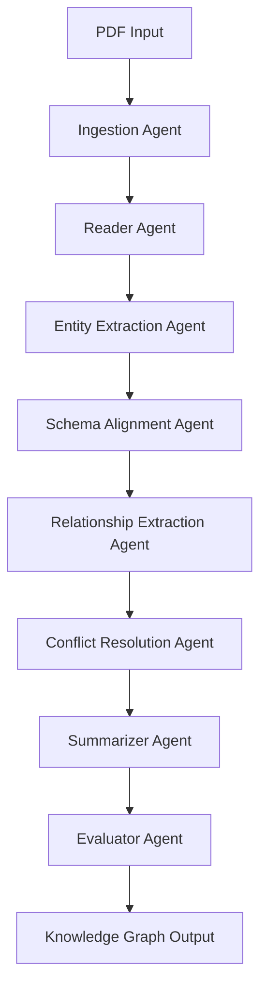

# KARMA: Leveraging Multi-Agent LLMs for Automated Knowledge Graph Enrichment 🤖

> 当前两阶段实验的运行、结果阅读和协作说明，请先看 [同事上手说明](同事上手说明.md)。以下保留原项目介绍。

[](https://opensource.org/licenses/MIT)
[](https://www.python.org/downloads/)
[](https://arxiv.org/abs/2502.06472)

KARMA is a cutting-edge natural language processing framework that leverages a coordinated multi-agent system to automatically extract, validate, and integrate scientific knowledge into structured knowledge graphs. By employing specialized Large Language Model (LLM) agents, KARMA ensures high-quality knowledge extraction while maintaining semantic consistency and domain expertise.


## 🌟 Key Features

### Multi-Agent Architecture
- **9 Specialized Agents**: Each agent handles a distinct stage of knowledge extraction
- **Coordinated Processing**: Agents work together in a carefully orchestrated pipeline
- **Quality Assurance**: Multi-stage validation with confidence, clarity, and relevance scoring

### Domain Expertise
- **Biomedical Focus**: Optimized for scientific literature processing
- **Entity Recognition**: Identifies diseases, drugs, genes, proteins, and other biomedical entities
- **Relationship Extraction**: Captures complex relationships like "treats", "causes", "inhibits"
- **Ontology Alignment**: Links entities to standard biomedical ontologies (UMLS, MeSH, NCBI)

### Production Ready
- **Scalable Design**: Handles both single documents and large-scale batch processing
- **Flexible Configuration**: Comprehensive configuration management system
- **Professional CLI**: Command-line interface for easy integration
- **Robust Error Handling**: Graceful handling of processing failures

## 📋 Table of Contents

- [Installation](#installation)
- [Quick Start](#quick-start)
- [Architecture](#architecture)
- [Usage Examples](#usage-examples)
- [API Reference](#api-reference)
- [Configuration](#configuration)
- [Contributing](#contributing)
- [Citation](#citation)
- [License](#license)

## 🚀 Installation

### Using pip (Recommended)

```bash
pip install karma-nlp
```

### From Source

```bash
git clone https://github.com/YuxingLu613/KARMA.git
cd KARMA
pip install -e .
```

### Development Installation

```bash
git clone https://github.com/YuxingLu613/KARMA.git
cd KARMA
pip install -e ".[dev]"
```

## ⚡ Quick Start

### Command Line Interface

```bash
# Process a PDF document
karma process document.pdf --api-key YOUR_OPENAI_KEY --output results.json

# Process with custom settings
karma process document.pdf --api-key YOUR_KEY --model gpt-4 \
  --relevance-threshold 0.3 --integration-threshold 0.7

# Create and use configuration file
karma config create --api-key YOUR_KEY --config-file karma_config.json
karma process document.pdf --config karma_config.json
```

### Python API

```python
from karma import KARMAPipeline, create_default_config

# Quick setup
config = create_default_config(api_key="your-openai-api-key")
pipeline = KARMAPipeline.from_config(config)

# Process document
result = pipeline.process_document("research_paper.pdf")

print(f"Entities found: {len(result.entities)}")
print(f"Relationships found: {len(result.relationships)}")
print(f"Processing time: {result.metrics.total_processing_time:.2f}s")
```

## 🏗️ Architecture

KARMA employs a sophisticated 9-agent architecture:



### Agent Descriptions

1. **Ingestion Agent**: Parses PDF documents and extracts structured text content
2. **Reader Agent**: Evaluates text relevance and scientific merit
3. **Entity Extraction Agent**: Identifies biomedical entities and concepts
4. **Schema Alignment Agent**: Maps entities to standard ontologies
5. **Relationship Extraction Agent**: Discovers semantic relationships between entities
6. **Conflict Resolution Agent**: Resolves contradictions and duplicates
7. **Summarizer Agent**: Creates concise summaries of extracted knowledge
8. **Evaluator Agent**: Validates extraction quality and confidence
9. **Knowledge Integrator**: Combines all outputs into final knowledge graph

## 💡 Usage Examples

### Basic Document Processing

```bash
karma process scientific_paper.pdf --api-key $OPENAI_API_KEY
```

### Batch Processing

```python
from karma import KARMAPipeline

pipeline = KARMAPipeline(api_key="your-key", model_name="gpt-4o")

for pdf_file in pdf_files:
    result = pipeline.process_document(pdf_file)
    print(f"Processed {pdf_file}: {len(result.entities)} entities")
```

### Custom Configuration

```python
from karma import KARMAConfig, ModelConfig, ProcessingConfig

config = KARMAConfig(
    model=ModelConfig(
        provider="openai",
        model_name="gpt-4o",
        api_key="your-key",
        temperature=0.1
    ),
    processing=ProcessingConfig(
        relevance_threshold=0.3,
        confidence_threshold=0.7,
        max_retries=3
    )
)
```

## 📚 API Reference

### Core Classes

#### `KARMAPipeline`
Main pipeline orchestrator for document processing.

**Methods:**
- `process_document(pdf_path: str) -> PipelineResult`
- `process_text(text: str) -> PipelineResult`
- `batch_process(file_paths: List[str]) -> List[PipelineResult]`

#### `BaseAgent`
Base class for all specialized agents.

**Key Features:**
- Async/sync processing support
- Automatic retry logic
- Token usage tracking
- Performance metrics

### Result Structure

```json
{
  "document_info": {
    "title": "Research Paper Title",
    "authors": ["Author 1", "Author 2"],
    "publication_date": "2024-01-01"
  },
  "entities": [...],
  "relationships": [...],
  "summary": "...",
  "metrics": {
    "prompt_tokens": 15420,
    "completion_tokens": 3240,
    "total_processing_time": 45.67,
    "confidence_score": 0.89
  }
}
```

## ⚙️ Configuration

### Configuration File Format

```json
{
  "model": {
    "provider": "openai",
    "model_name": "gpt-4o",
    "api_key": "your-api-key",
    "temperature": 0.1,
    "max_tokens": 4096
  },
  "processing": {
    "relevance_threshold": 0.3,
    "confidence_threshold": 0.7,
    "max_retries": 3,
    "batch_size": 10
  }
}
```

### Environment Variables

```bash
export KARMA_API_KEY="your-api-key"
```

## 🤝 Contributing

We welcome contributions! Please see our contributing guidelines for:

- Code style and standards
- Testing requirements
- Pull request process
- Issue reporting

## 📖 Citation

If you use KARMA in your research, please cite:

```bibtex
@article{karma2025,
  title={KARMA: Leveraging Multi-Agent LLMs for Automated Knowledge Graph Enrichment},
  author={Authors TBD},
  journal={arXiv preprint arXiv:2502.06472},
  year={2025}
}
```

## 📄 License

This project is licensed under the MIT License - see the [LICENSE](LICENSE) file for details.
