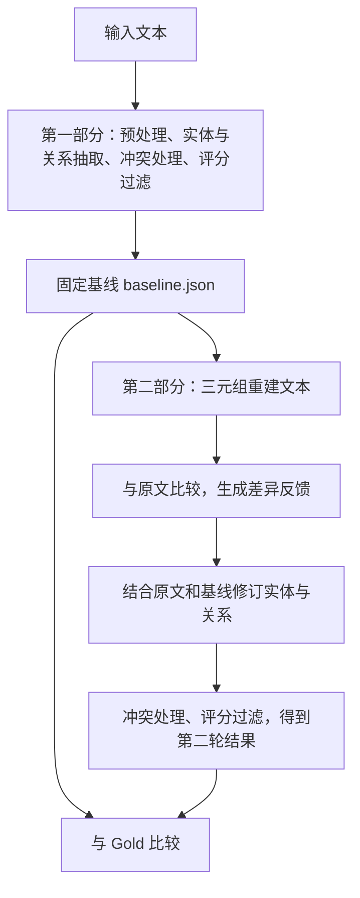

# KARMA 同事上手说明

AI 辅助整理，按 2026-10-10 当前代码核对。本文以运行和分析实验为主；仓库原 README 介绍的是原项目，当前实验请先按本文操作。

## 1. 这份代码做什么

从文本抽取 `(head 主体, relation 关系, tail 客体)`，再根据原文检查第一轮结果，通过新增、删除、替换三元组进行第二轮修订。当前使用中文 Prompt；抽取出的三元组保留输入原文语言，所以英文数据的结果仍是英文。



要点：

- **第一轮只跑一次，第二部分可以反复运行**，每次都从同一基线出发，不在上一次第二轮结果上继续修改。
- Gold 是评估用的参考答案，**不输入抽取、反馈和修订过程**。
- 反馈由“实际抽取文本”和“第一轮三元组重建文本”比较产生；第二轮还直接读取原文、第一轮实体与三元组，不只依赖反馈。
- `Summarizer` 默认跳过，实体计数、Schema Alignment 的相关调用有意停用，请保持现状。Reader 会运行，但默认抽取使用规范化后的原文，不是仅使用筛出的相关片段。
- 管线内 `EvaluatorAgent` 按模型自评分过滤；它与外部 Gold 评估是两件事。当前过滤阈值为 0，不代表准确率为 100%。

## 2. 准备环境和模型

以下命令均在项目根目录执行。Windows 推荐 Git Bash / MINGW64；目录名不必与原作者电脑相同。

```bash
git clone https://github.com/lichuanpei12-coder/KARMA.git
cd KARMA
python -m pip install -r requirements.txt
# 旧 evaluate.py 和管线回归测试需要 numpy；httpx 用于模型客户端。
python -m pip install numpy httpx
python -B -m unittest discover -s tests
```

当前本机核验环境为 Python 3.10.8，33 项离线测试通过。运行抽取需要模型额度和网络；严格/宽松词匹配评估不调用模型。

在项目根目录新建本机 `.env`，按选用的模式填写自己的配置。该文件不上传 Git，向项目负责人获取接口信息与凭据，不把密钥写到代码或结果里。

```dotenv
# 模式 0：Chat Completions
KARMA_API_KEY=填入自己的密钥
KARMA_BASE_URL=填入服务地址
KARMA_MODEL=填入模型名称

# 模式 1：Responses
KARMA_PROXY_API_KEY=填入自己的密钥
KARMA_PROXY_BASE_URL=填入服务地址
KARMA_PROXY_MODEL=填入模型名称
```

在 [main.py](main.py) 顶部设置 `API_MODE`：0 读取第一组，1 读取第二组。**当前代码默认是 0，已有第一篇示例使用的是 1、模型 gpt-5.5。** 如要沿用示例配置，设置为 1 并配置对应服务；不能只改模型名而忽略接口模式。两阶段应使用同一服务和模型。系统环境变量优先于 `.env`。

`KARMA_USE_SUMMARIZER` 默认不要设置：代码以“非空”判断启用，字符串 `0` 或 `false` 也会启用。

## 3. 当前输入与准备运行的 5 篇

输入：[data/DocIOE/DocOIE_transportation_gold_input.json](data/DocIOE/DocOIE_transportation_gold_input.json)。

格式是“文档标题 → 句子列表”。每篇包含 10 个目标句，并非整篇专利全文。文件共 40 篇、400 个目标句；对应 Gold 共 1137 条，每篇 20～37 条，平均约 28.4 条。

Gold 目录：[data/DocIOE/transport](data/DocIOE/transport)。`0.json` 对应输入第 1 篇，依次类推。程序保留文档 ID 和原始位置，选子集时不要自行重新编号 Gold。

当前 [run_baseline.sh](run_baseline.sh) 的 `SAMPLE_LIMIT=5`，选的是**文件顺序前 5 篇，不是随机抽 5 篇**：

| 顺序 | 输入起始行 | 文档内容 | Gold |
|---|---:|---|---|
| 1 | 2 | 车辆身份的密码学保证 | `transport/0.json` |
| 2 | 14 | 网络拥塞信息 | `transport/1.json` |
| 3 | 26 | 篷布支架系统 | `transport/2.json` |
| 4 | 38 | 橡胶复合材料及制备方法 | `transport/3.json` |
| 5 | 50 | 通信路径管理方法与系统 | `transport/4.json` |

行号对应当前格式；标题更适合长期定位。检查原文时，简单区分技术内容、专利套话、上下文不足即可。Gold 仍可能存在错字、重复、漏标或粒度争议，不要把每个未匹配项直接判成抽取错误。

## 4. 日常运行：只需要两个脚本

### 第一次：生成 5 篇基线

```bash
bash run_baseline.sh
```

常改的设置都在这个脚本开头：

```bash
DATASETS=("data/DocIOE/DocOIE_transportation_gold_input.json")
SAMPLE_LIMIT=5
INTEGRATION_THRESHOLD=0
```

`SAMPLE_LIMIT=0` 表示脚本不传数量限制，运行全部；命令行直接用 `--limit` 时必须为正数。`main.py` 负责接收脚本传来的值，没有第二个需要同步修改的固定篇数。

成功后，每个数据集生成一个基线包：

```text
outputs/baselines/<时间戳_进程号>/1_DocOIE_transportation_gold_input/baseline.json
```

脚本把路径写进 `outputs/current_baselines.txt`。这个清单仅在全部基线生成成功后启用；失败时先处理报错，不要直接运行第二部分。

### 第二次：在固定基线上运行修订

```bash
bash run_revision.sh
```

默认自动读取 `outputs/current_baselines.txt`，不需要再次设置篇数。结果写入：

```text
outputs/revisions/<新的时间戳_进程号>/1_1_DocOIE_transportation_gold_input/
```

优化第二部分后，只重跑 `run_revision.sh`，每次创建新目录。**不要为了重跑第二轮而重新执行 baseline 脚本**，否则得到的是一份新基线，比较时增加了变量。

如需换成指定基线，在 `run_revision.sh` 顶部填写：

```bash
BASELINE_FILES=("outputs/baselines/实际运行目录/1_DocOIE_transportation_gold_input/baseline.json")
```

填写后优先用这些路径；恢复 `BASELINE_FILES=()` 才重新读取默认清单。不要手工编辑 `baseline.json`，加载时会核验其哈希；需要新基线就另跑、另存。

原来的 `bash run_datasets.sh` 仍按文档连续执行完整两轮，**不会读取 `SAMPLE_LIMIT=5`**；当前脚本会处理配置数据集的全部样本。固定基线实验请用上面两个脚本。

### 需要自己命名实验目录时

以下示例路径可自行修改；baseline/revise 的输出目录必须不存在或为空。

```bash
python main.py --stage baseline --input "data/DocIOE/DocOIE_transportation_gold_input.json" --limit 5 --integration-threshold 0 --output-dir "outputs/baselines/dev5_v1"
python main.py --stage revise --baseline "outputs/baselines/dev5_v1/baseline.json" --output-dir "outputs/revisions/dev5_prompt_v1"
```

直接运行这两个 Python 命令不会更新 `current_baselines.txt`。若之后改用脚本，需要显式设置 `BASELINE_FILES`。可用 `--doc-ids` 选择完整文档标题；筛选保持输入原顺序。

补充：当前 CLI 的 `--domain` 默认仍为 `biomedical`，脚本没有另设 domain；这是现有配置，不能误认为已自动识别交通领域。若调整它，要记录为实验配置变化。第二部分自动继承基线过滤阈值，但模型、API 和当前代码不会自动恢复到生成基线时的版本。

## 5. 输出在哪里、每种文件怎么用

第一部分目录和第二部分目录结构相似；**baseline 包是可复用输入，图谱/CSV 是查看结果，两者用途不同**。

| 文件 | 内容与用途 |
|---|---|
| `baseline.json`（第一部分） | 原文、实际抽取文本、初始实体/关系、第一轮最终三元组、预处理状态、固定冲突上下文、配置与哈希；第二部分的完整输入 |
| `knowledge_graph_时间戳.json` | 本次运行汇总图谱；第一部分汇总 R1，第二部分汇总 R2 |
| `all_relationships_时间戳.csv` | 便于表格阅读的抽取关系和分数，不是 Gold 匹配评估表 |
| `intermediate_results_时间戳.json` | 过程、各阶段结果及耗时等，定位流程问题时看 |
| `details/_run_manifest.json` | 按文档 ID 保存每轮最终三元组和运行配置；`complete=true` 表示管线正常完成，外部评估优先读这个文件 |
| `details/000_时间.json` 等 | 单次内部评分后的三元组；编号是调用顺序，不要靠文件编号猜 R1/R2，按清单对应 |
| `details/_evaluation_编号_candidates.json` | 评分过滤前候选及自评分，用于检查为什么保留或过滤 |
| `details/_dump_doc编号_r0_entities.json` / `r0_relationships.json` | 第一轮候选实体/关系；`r0` 表示第一轮 |
| `details/_dump_doc编号_r1_entities.json` / `r1_relationships.json` | 第二轮修订后的候选；`r1` 表示第二轮，并非第一轮 |
| `details/*entity_audit.json` / `*relationship_audit.json` | 解析、实体或第一轮关系处理记录；字段依阶段不同 |
| `details/_dump_doc编号_feedback.json` | 原文与重建文本的比较反馈，排查反馈有没有漏报或误报 |
| `details/_dump_doc编号_r1_revision.json` | 关系修订操作记录 |
| `details/_dump_doc编号_revision_result.json` | 最重要的修订对照：基线、接受/拒绝操作、修订后、冲突处理后、最终结果 |
| `details/_dump_doc编号_final_entities.json` | 最终图谱实体节点 |

`doc编号` 是输入原始位置，从 0 开始。新增两阶段目录在 `outputs/`；旧完整流程的明细仍保存在 `data/result/`。不要只按“最新文件夹”判断属于哪次实验，查看运行清单。

### 重点：第二轮具体修改怎么看

打开 `*_revision_result.json`，优先看 `revision_audit.accepted`：

- `add`：新增；`before=null`，`after` 是新三元组。
- `remove`：删除；`before` 是原三元组，`after=null`。
- `replace`：替换；`before` 与 `after` 相邻展示，不必再去 CSV 查旧值。
- `index`：被操作的基线位置，从 0 开始；`reason` 是理由，`evidence` 是模型给出的原文证据。
- `rejected`：未执行的提议及拒绝原因，例如三元组字段为空。

`accepted` 只说明通过程序校验，不代表语义正确；`before/after` 是操作时快照。还要看 `after_revision`（含去重）、`after_conflict_resolution`、`final`，确认最终是否保留。

程序检查操作索引、冲突操作、必要字段等；目前未自动验证所有证据都确实来自原文，也不能保证指代和事实正确。`confidence/clarity/relevance` 是模型自评分。仅更新证据/评分也可能出现一次 replace，不能把替换次数都当作纠正事实的数量。

## 6. 跑 Gold 评估和分析问题

抽取脚本结束后，**另外执行评估**。把下面结果目录换成本次第二部分的目录：

```bash
python evaluate_lenient.py "outputs/revisions/dev5_prompt_v1" "data/DocIOE/transport" --compare-strict --output-dir "outputs/evaluations/dev5_prompt_v1"
```

该目录中的清单同时保存固定的 R1 和本次 R2，因此一次即可比较两轮；不需要把基线和第二部分 JSON 手动拼起来。只评估第一部分时，第一个参数换成 baseline 的输出目录，报告只有 R1。不同实验使用不同评估输出目录，避免覆盖。

| 评估文件 | 先看什么 |
|---|---|
| `eval_comparison.json` | strict/lenient 的 R1、R2 micro P/R/F1 及差值，再看逐文档表现；`csv_verified` 表示导出一致性核验通过 |
| `match_comparison.csv` | 用 Excel 打开，按 `metric`、`round`、`doc` 筛选，再对照 Gold 与预测的三个字段 |

CSV 的 `matched` 是已配对；宽松模式下不等于完全正确。`gold_unmatched` 提示可能漏抽，`pred_unmatched` 提示可能多抽，但也可能是表达差异或 Gold 问题。

评估口径：严格模式清理空白后逐字段完全一致，保留大小写、标点、词序；宽松模式小写后按空白分词，三个字段分别有词重合才允许配对，按重合词计部分分，再做文档内一对一匹配。以 micro P/R/F1 为主，**宽松分数不是事实正确概率**。当前宽松分词不能自动适配无空格中文，后续换中文数据需先定评估规则。

旧 [evaluate.py](evaluate.py) 保留了嵌入相似度评估；它和新的词匹配分数不能混用。具体规则见 [词匹配评估说明.md](词匹配评估说明.md)。VS Code 用户也可用仓库 `.vscode/launch.json` 的“运行和调试”配置，默认针对已有第一篇示例，换实验前修改 `args`。

**每次按这个顺序分析：**

1. 核对清单 `complete`、基线哈希、样本 ID、模型、Gold 版本，确认可比。
2. 看总体和逐篇 R1/R2 分数，确定哪些文档改善、哪些退步。
3. 看低分匹配、未匹配项，以及所有 add/remove/replace/rejected。
4. 回到原文判断：抽取错误、表达/粒度差异、Gold 问题、程序拒绝，分别记录。
5. 优先修复反复出现的同类问题，一次改一个重点，再用固定基线验证。

建议使用下面的记录表；这是人工实验记录，不是程序自动输出：

| 实验/样本 ID | 原文证据 | Gold | 修改前 | 修改后 | 问题分类与原因 | 下一步 |
|---|---|---|---|---|---|---|
| 填写 | 填写 | 填写 | 填写 | 填写 | 指代/否定/遗漏/误删/Gold争议等 | 填写 |

## 7. 已有示例和当前下一步

截至本文核对时，**第一篇已完成真实运行，前 5 篇批量实验尚未启动**。

- 第一篇基线：[outputs/baselines/first_document_20261009_60671500](outputs/baselines/first_document_20261009_60671500)
- 第一篇第二部分：[outputs/revisions/first_document_20261009_60671500](outputs/revisions/first_document_20261009_60671500)
- 第一篇评估：[outputs/evaluation_20261010/revision](outputs/evaluation_20261010/revision)
- 最方便先读的人工对照：[第一篇结果对照.md](outputs/first_document_20261009_60671500/第一篇结果对照.md)

该篇 Gold 35 条，R1/R2 各 31 条；接受新增 2、删除 2、替换 4，拒绝新增 1。严格 F1 均约 3.03%，宽松 F1 约 47.79% → 50.41%。同一 `which` 在不同操作中被解释为不同对象，说明分数上涨仍可能存在错误。它只是流程和阅读示例，不能作为稳定提升的结论。

下一步按以下顺序开展：

1. 看前 5 篇共 50 个目标句，标记套话、技术内容和缺上下文；核查明显 Gold 错误并单独记录。保留原版，不根据模型输出任意修改 Gold。
2. 确定接口/模型后跑 5 篇 baseline，再跑当前版本 revision 和外部评估，作为本轮参照。
3. 固定输入、Gold、基线、模型、阈值和评估口径；比较“R1、当前 R2、优化后 R2”，不要只看 R1→新 R2。
4. 优化 Prompt 时一次处理一个问题。第一轮与第二轮可能共享规则：修改共享规则后继续使用已保存基线，第一轮结果仍不变；若重跑第一轮，应建立新一组实验。
5. 小批问题收敛后，建议扩展到固定 20 篇开发集，另 20 篇保留验证；这只是后续建议，当前尚未创建该划分。对选定方案重复第二部分 3 次，观察稳定性，不能只挑最好一次。
6. 当前专利数据够做流程和局部优化；正式证明泛化效果时再补非专利数据。已有中文候选仅下载/查看，尚未正式接入，不要直接混入当前评估。

可参考的数据目录：[dataset_versions](data/dataset_versions/版本目录说明.md)、[dataset_samples](data/dataset_samples)、[SpanSAOKE](data/SpanSAOKE)、[APRCOIE](data/APRCOIE)。数据候选存在标注粒度、符号表达和完整性问题，不能仅因有三个字段就当作适配完毕。

## 8. 修改代码时先看这些位置

| 文件 | 负责什么 |
|---|---|
| [main.py](main.py) | API 模式、命令行参数、阶段入口、顶层输出 |
| [run_baseline.sh](run_baseline.sh)、[run_revision.sh](run_revision.sh) | 日常运行配置、输出目录和基线路径衔接 |
| [karma/core/pipeline.py](karma/core/pipeline.py) | 两阶段执行顺序、反馈输入、各阶段记录 |
| [karma/core/run_artifacts.py](karma/core/run_artifacts.py) | 基线保存、校验、文档选择 |
| [实体 agent](karma/agents/entity_extraction/agent.py) | 实体第一轮抽取与第二轮修订 Prompt |
| [关系 agent](karma/agents/relationship_extraction/agent.py) | 共享规则、两轮关系 Prompt、增删替换校验与 before/after 记录 |
| [文本重建 agent](karma/agents/text_generation/agent.py)、[比较 agent](karma/agents/text_comparison/agent.py) | 根据三元组重建文本，比较原文与重建文本 |
| [extraction_support.py](karma/agents/extraction_support.py) | JSON 解析、字符串清理、分数校验；当前不存放 Prompt |
| [evaluation_common.py](evaluation_common.py) | 外部评估的加载、匹配、计分、CSV 和 JSON 导出 |

两位同事可以分别负责“样本/Gold 核查与错误归类”和“运行/Prompt 修改与复测”；修改前同步本次负责文件和实验编号，避免同时改同一规则。提交代码时记录实验版本，实验输出目录也使用可区分名称。

跨文档注意：原完整流程中后续文档可能看到前面文档的 R2 图谱；baseline-only 运行看到前面文档的 R1 图谱。因此，新生成的多篇 baseline 与旧 full 运行不保证完全相同。正式对比应在同一份固定基线上开展。更多阶段接口细节见 [两阶段运行说明.md](两阶段运行说明.md)。

## 9. 本次 Git 交付范围

上传当前项目代码、运行/评估脚本、测试、使用说明、已有实验结果、数据及其版本/审查材料、研究资料。`.env`、本机私有配置、日志、Python 缓存、`.codex/` 和 `tmp/` 临时工作文件不上传；本地旧版目录按原有忽略规则保留。下载的大数据已随项目提供，克隆可能较慢。

历史结果中的来源路径可能保留原电脑绝对路径，仅用于追溯；同事运行命令使用自己克隆目录中的实际相对路径即可。原始实验结果不因换电脑而手工改写。
